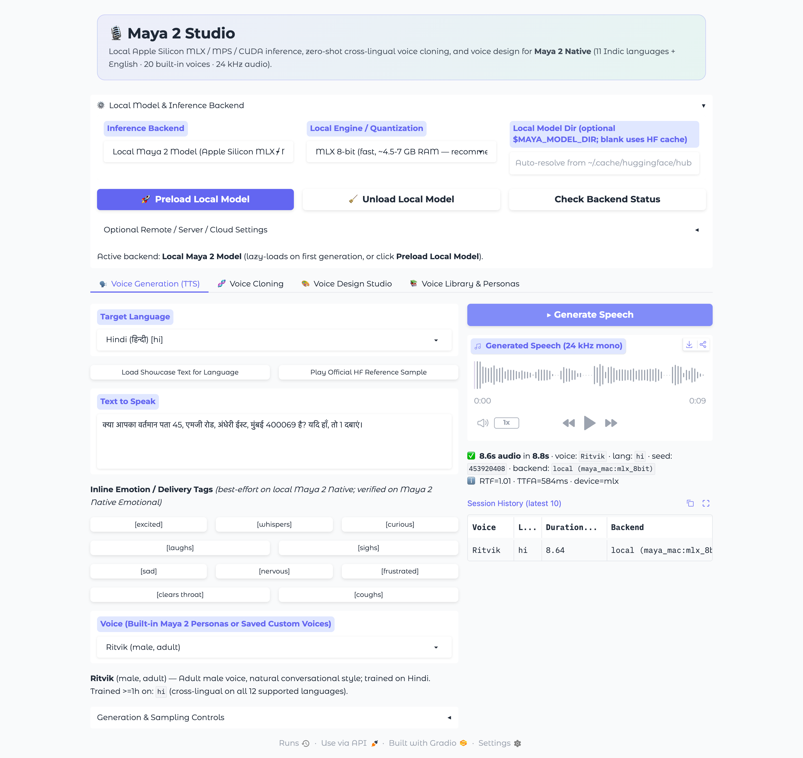
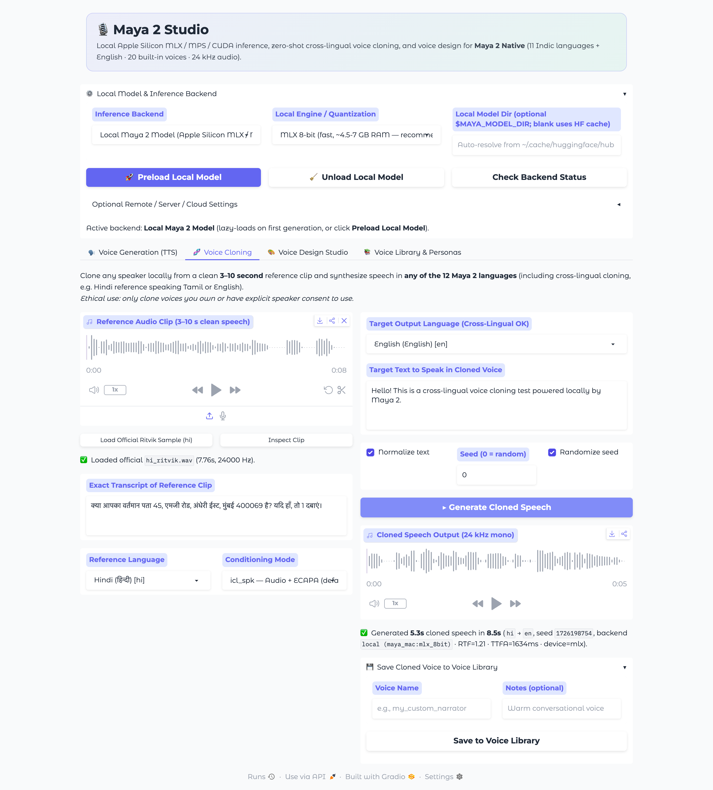
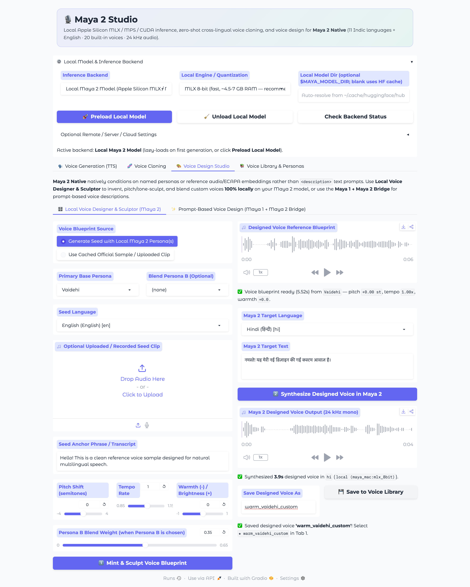
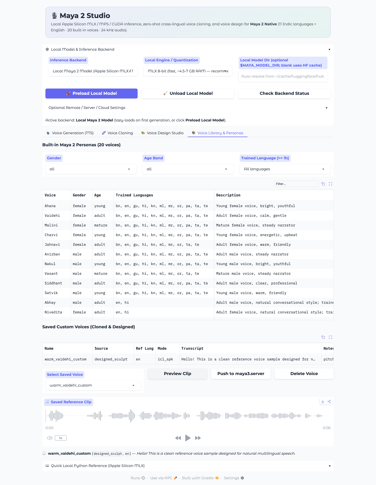

# Maya 2 Studio

A **Gradio 6** interactive studio for running **Maya 2 Native** (`maya-research/maya2-native`) **locally on Apple Silicon (MLX / Metal / MPS)** or Linux CUDA, with **zero-shot cross-lingual voice cloning** and **voice design**.

## Screenshots

### 1. Voice Generation (TTS)
Generate speech across 12 languages and 20 built-in personas (plus saved custom voices), with inline emotion/delivery tags, text normalization, reproducible seeds, and live `RTF` / `TTFA` telemetry.



### 2. Zero-Shot & Cross-Lingual Voice Cloning
Upload or record a 3–10 s reference clip (or load the official `hi_ritvik.wav` sample), inspect audio stats, choose `icl_spk` / `icl` / `spk` conditioning, synthesize in any target language, and save custom voices locally.



### 3. Voice Design Studio
Create custom voices **100% locally** via the **Maya 2 Voice Designer & Acoustic Sculptor** (persona seeding, two-persona blending, phase-vocoder pitch shifting, tempo scaling, and spectral warmth/brightness EQ), or use the **Maya 1 → Maya 2 Prompt Bridge**.



### 4. Voice Library & Personas
Filter all 20 built-in Maya 2 personas by gender, age band, and trained languages, preview saved cloned/designed voices, or push them to a self-hosted `maya3.server`.



---

## Features

- **Local Maya 2 Inference (`local` backend, default):**
  - Uses Apple Silicon **MLX** with custom Metal kernels via `maya-mac` (default `mlx_8bit` fits cleanly in 16 GB unified memory; also supports `mlx_fp16`, `mlx_bf16`, `mlx_4bit`, `torch_mps`, and Linux CUDA `maya3`).
  - Automatically resolves cached `maya-research/maya2-native`, `kyutai/mimi`, and `speechbrain/spkrec-ecapa-voxceleb` weights from the Hugging Face cache (or `$MAYA_MODEL_DIR`).
  - Preload / Unload controls and live RTF / TTFA telemetry.

- **Voice Generation (TTS):**
  - All **12 supported languages** (`as`, `bn`, `en`, `gu`, `hi`, `kn`, `ml`, `mr`, `or`, `pa`, `ta`, `te`).
  - All **20 built-in Maya 2 personas** (`Ahana`..`Tanushree`) plus `plain` and custom saved voices.
  - Inline emotion/delivery tags (`[excited]`, `[whispers]`, `[curious]`, `[laughs]`, `[sighs]`, `[sad]`, `[nervous]`, `[frustrated]`, `[clears throat]`, `[coughs]`), text normalization, reproducible seeds, and sampler overrides (`temperature`, `top_k`, `top_p`, `repetition_penalty`).

- **Zero-Shot & Cross-Lingual Voice Cloning:**
  - Upload or record a 3–10 s reference clip (or load the official `hi_ritvik.wav` sample).
  - Supports `icl_spk`, `icl`, and `spk` conditioning modes (`spk` works locally without a transcript).
  - Save cloned voices into a persistent local Voice Library (`~/.cache/maya2-studio/voices`).

- **Voice Design Studio:**
  - **Local Voice Designer & Sculptor (Maya 2):** Generate seed voice(s) locally from any Maya 2 persona(s) (optionally blend two personas), sculpt pitch (semitones), tempo, and spectral warmth/brightness, synthesize in any of the 12 languages locally, and save to your Voice Library.
  - **Prompt-Based Voice Design (Maya 1 → Maya 2 Bridge):** Optional natural-language trait builder via Maya 1 Space whose prototype feeds directly into local Maya 2 cross-lingual cloning.

## Quickstart

```bash
uv sync --extra dev
uv run maya2-studio
```

Open **http://127.0.0.1:7860** in your browser.

### Optional CLI flags

```bash
uv run maya2-studio --backend local --precision mlx_8bit --port 7860
```

Available `--backend` values:
- `local` *(default)* — Runs locally via `maya-mac` (Apple Silicon MLX / MPS) or `maya3` (Linux CUDA).
- `maya3_server` — Connects to a self-hosted `maya3.server` HTTP endpoint (`--server-url http://host:8080`).
- `hf_studio` — Connects to Hugging Face Space `maya-research/maya2-native-studio`.
- `hf_community` — Connects to Hugging Face Space `hugging-apps/maya2-native`.
- `maya_cloud` — Connects to `https://tts.mayaresearch.ai/v1/tts` using `MAYA_API_KEY`.

## Tests

```bash
uv run pytest -v
```
